<div align="center">
  

  <h1>Freecat Blog</h1>

  <p>本地写作、GitHub 备份、免费部署的个人博客模板</p>

  <p>简体中文 | <a href="README.en.md">English</a></p>

  <p>
    
    
    
    
  </p>

  <p>
    <a href="https://freecat-blog.pages.dev">演示站点 01</a> |
    <a href="https://freecat-blog-op.pages.dev">演示站点 02</a>
  </p>
</div>

## Freecat Blog 是什么

Freecat Blog 将 Markdown 文章构建为静态网站。你在本地编辑文章，将提交推送到 GitHub 后，由 Cloudflare Pages 或 Vercel 构建并发布。日常写作不需要编写代码或维护服务器。

原稿保存在电脑中；推送后，GitHub 仓库也会保存对应版本。

```text
本地：在 writing/ 写文章，在 Control/ 设置网站信息
        ↓ 保存、提交并推送
GitHub：保存已推送的版本
        ↓ 部署平台检测到新提交
Cloudflare Pages / Vercel：构建并发布
        ↓ 部署成功
网站：显示新内容
```

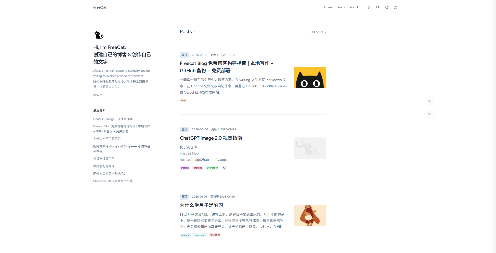

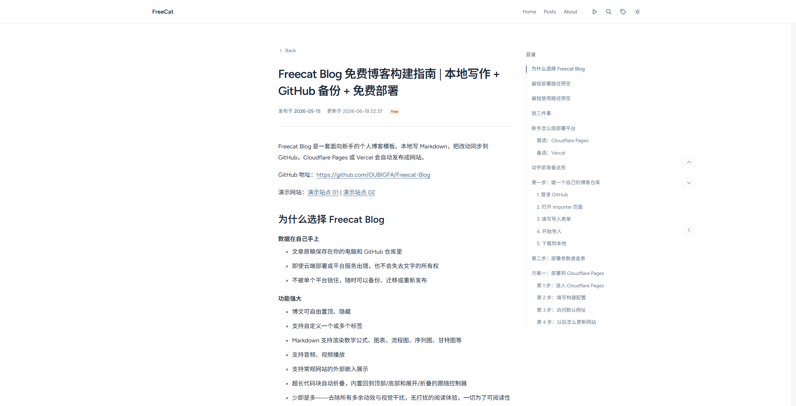

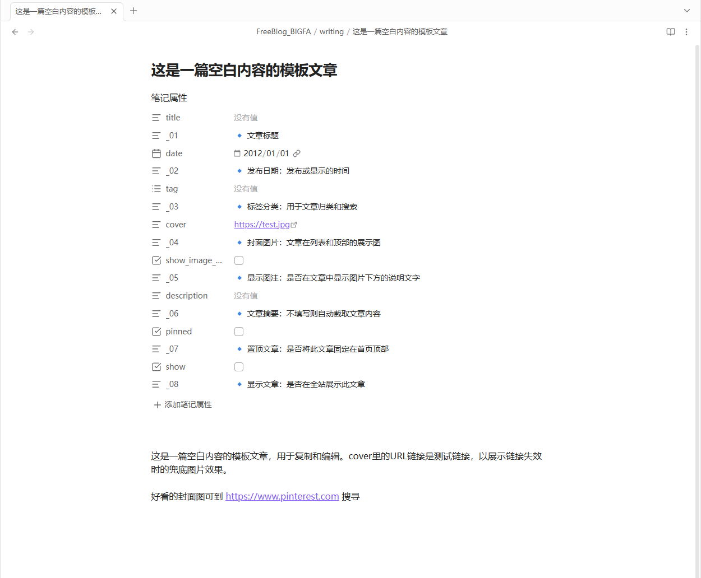

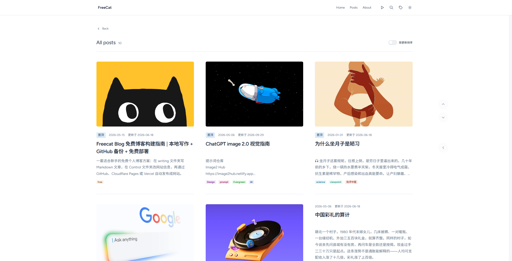

主要功能：

- 生成首页、文章页、归档页、搜索页和 About 页面。
- 设置文章标签、封面、摘要、置顶和显示状态。
- 渲染数学公式、图表、流程图和甘特图。
- 在文章中嵌入音频、视频和允许嵌入的外部网页。
- 调整中英文混排间距，折叠超长代码块。
- 生成 Sitemap（站点地图）、RSS（订阅源）和 llms.txt（供 AI 工具读取的站点说明）。相关设置见 `Control/SEO_搜索优化.md`。
- 通过配置文件设置网站名称、头像、社交链接和主题。

## 图表引擎与回退

文章继续使用 `mermaid` 代码围栏，默认由锁定版本的 [Pele](https://pele.run) 渲染。构建会将引擎和 MIT 许可证复制到 `/assets/pele/`，仅含图表的文章加载它；`echarts` / `chart` 代码块仍使用 ECharts。

- 图表沿用站内字体，浅深色切换不重新渲染。复杂宽图可用缩放按钮、双指缩放或 `Ctrl` / `⌘` + 滚轮放大，再拖动查看；普通滚轮仍滚动页面。
- 甘特图保留时间轴画布宽度，避免随正文收窄时把短任务名挤到色块外；小屏先显示全图，可放大并拖动查看。其他图表仍按容器自适应布局。
- Mermaid 语法不等于 Mermaid 的像素级布局。`<br/>` 换行已验证，任意 HTML 标签和 JavaScript `click` 回调不支持；URL 链接保留。
- 需要回退时，在部署平台设置构建环境变量 `DIAGRAM_ENGINE=mermaid` 后重新构建。移除该变量或设置为 `pele` 即恢复默认。未知值会使构建报错，不会静默降级。旧引擎回退仍使用原 Mermaid CDN，不能视为离线方案。
- 暂不启用构建期 SVG：本地字体测量可行，但单一静态布局缩到手机后文字过小。待多宽度布局与阅读交互验证通过再启用，不为此改文章源码或引入 Ondine。

在 `all/` 下运行 `npm test`、`npm run build`；预览地址为 `http://127.0.0.1:4173`，浏览器验证用 `npm run test:browser`。Mermaid 旧实现仅在回退窗口内保留，确认新引擎稳定后再清理。

## 目录用途

| 目录 | 用途 | 何时修改 |
| --- | --- | --- |
| `writing/` | 文章原稿 | 新增或修改文章时 |
| `Control/` | 网站配置 | 修改网站信息时 |
| `all/` | 模板、资源和构建程序 | 修改模板功能时；日常写作不需要修改 |

部署平台的根目录填 `all`。完整教程也可在[《Freecat Blog 免费博客构建指南》](<writing/Freecat Blog 免费博客构建指南.md>)中查看。

## 部署前准备

本指南使用 GitHub Desktop 提交并推送文件。推送是把本地提交上传到 GitHub 的操作。熟悉 Git 的用户也可以使用其他 Git 工具。

| 工具或账号 | 何时需要 | 用途 | 地址 |
| --- | --- | --- | --- |
| GitHub 账号 | 必需 | 保存博客仓库 | <https://github.com/signup> |
| GitHub Desktop | 按本指南操作时 | 提交并推送本地文件 | <https://desktop.github.com/download> |
| Markdown 编辑器 | 必需 | 编辑文章和配置文件，可选 Obsidian 或 VS Code | <https://obsidian.md/zh> |
| Cloudflare 账号 | 选择 Cloudflare Pages 时 | 构建并发布网站 | <https://dash.cloudflare.com/sign-up> |
| Vercel 账号 | 选择 Vercel 时 | 构建并发布网站 | <https://vercel.com/signup> |

选择一个部署平台即可。首次部署建议使用 Cloudflare Pages；已有 Vercel 项目的用户可继续使用 Vercel。免费方案受平台的额度和使用条款限制。

## 第 1 步：创建博客仓库

1. 登录 GitHub。
2. 打开 [Import a repository](https://github.com/new/import)。
3. 按下表填写导入信息。

   | 字段 | 填写值 |
   | --- | --- |
   | `Your old repository's clone URL` | `https://github.com/OUBIGFA/Freecat-Blog` |
   | `Owner` | 你的 GitHub 账号 |
   | `Repository name` | 自定名称，例如 `my-freecat-blog` |
   | `Privacy` | `Private` |

4. 点击 `Begin import`。
5. 等待页面显示 `Your new repository ... is ready`。
6. 打开新仓库。
7. 确认仓库中有 `all/`、`Control/` 和 `writing/`。

然后将仓库下载到电脑：

1. 打开 GitHub Desktop。
2. 选择 `File` → `Clone repository`。
3. 选择刚导入的仓库。
4. 选择保存仓库的本地文件夹。
5. 点击 `Clone`。

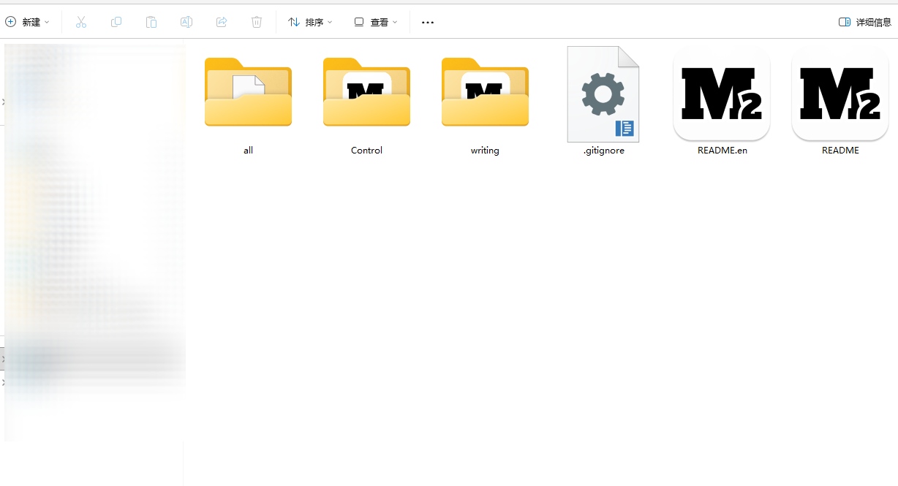

## 第 2 步：部署网站

### Cloudflare Pages（推荐）

平台界面的名称可能随版本变化。以下截图用于定位入口；构建参数以表格为准。

1. 登录 [Cloudflare Dashboard](https://dash.cloudflare.com/)。
2. 点击「创建应用程序」。

   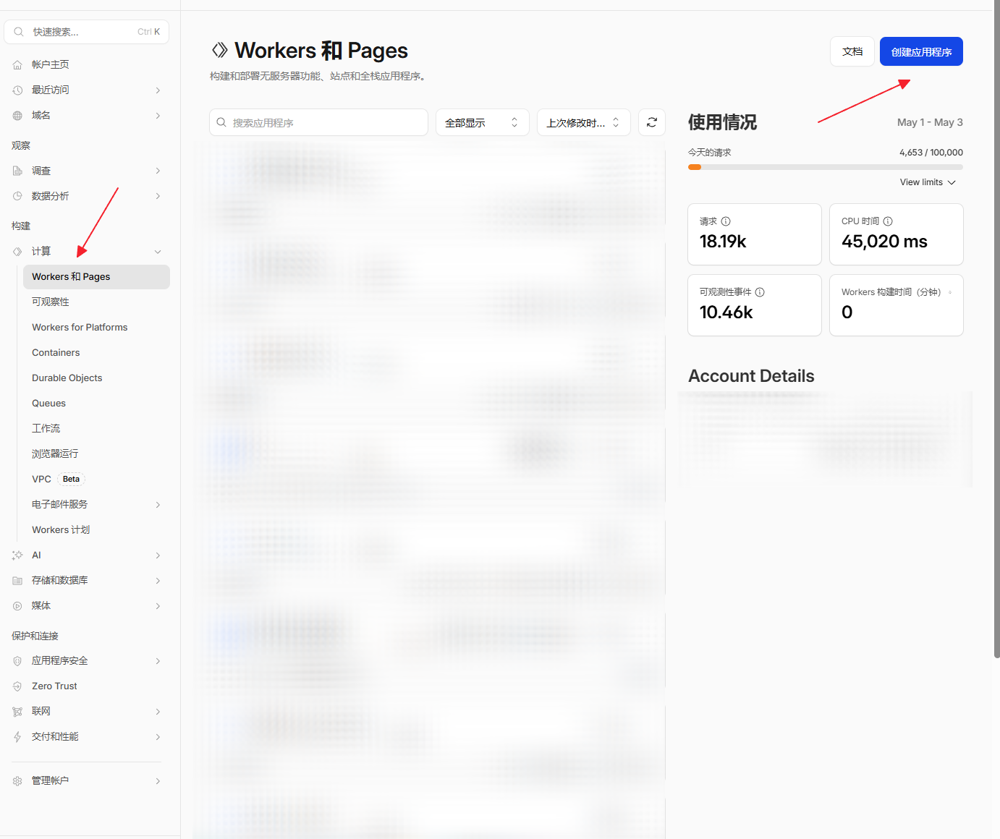

3. 选择 `Pages`。

   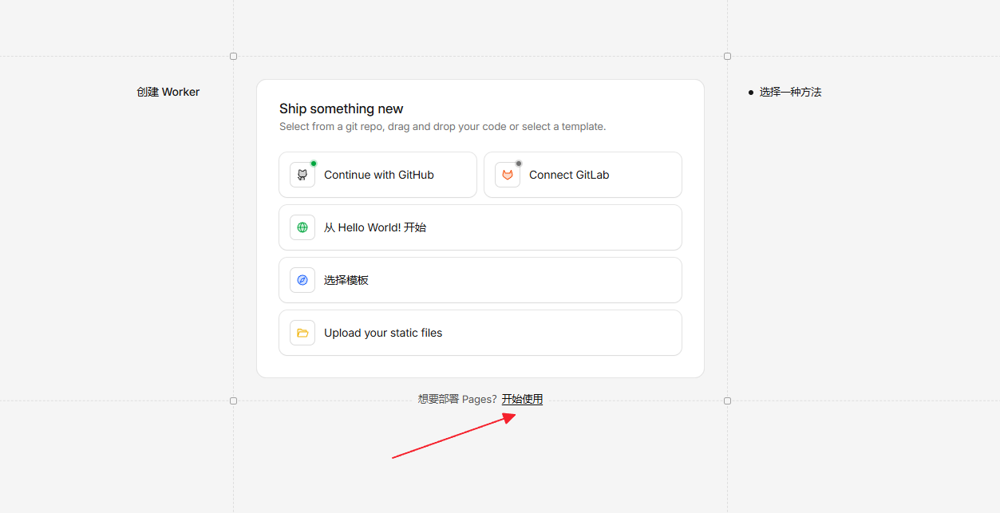

4. 选择「导入现有 Git 仓库」。

   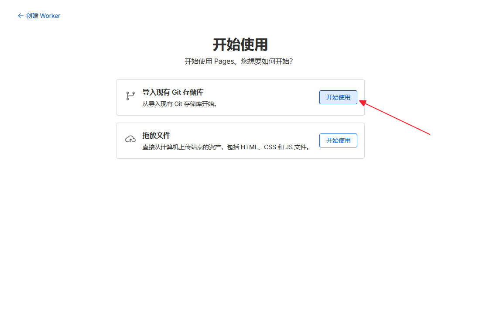

5. 如果尚未连接 GitHub，按页面提示授权 Cloudflare 访问你的博客仓库。
6. 选择你的博客仓库。

   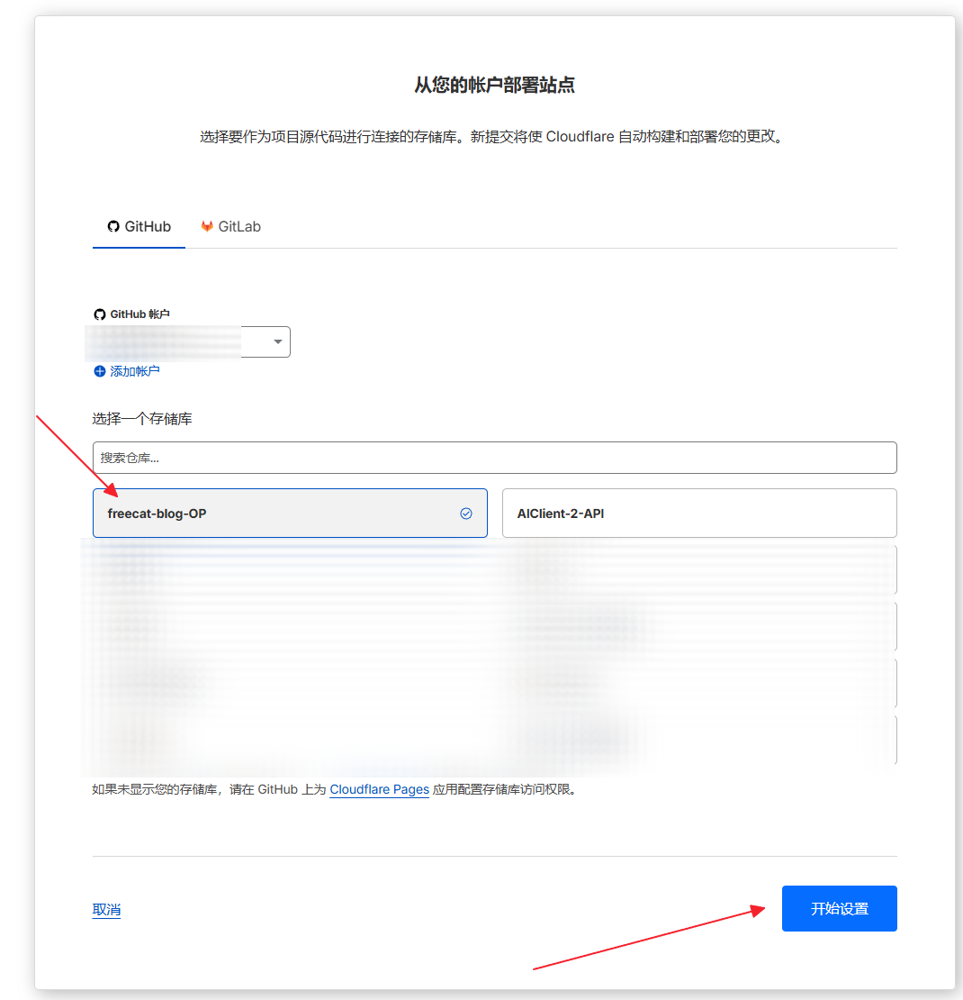

7. 输入项目名称。
8. 按下表设置构建参数。

   | 中文界面 | English UI | 填写值 |
   | --- | --- | --- |
   | 框架预设 | Framework preset | `None`（无） |
   | 根目录（高级） | Root directory (advanced) > Path | `all` |
   | 构建命令 | Build command | `npm run build` |
   | 构建输出目录 | Build output directory | `dist` |
   | 环境变量（建议填写） | Environment variables | `NODE_VERSION` = `20` |

   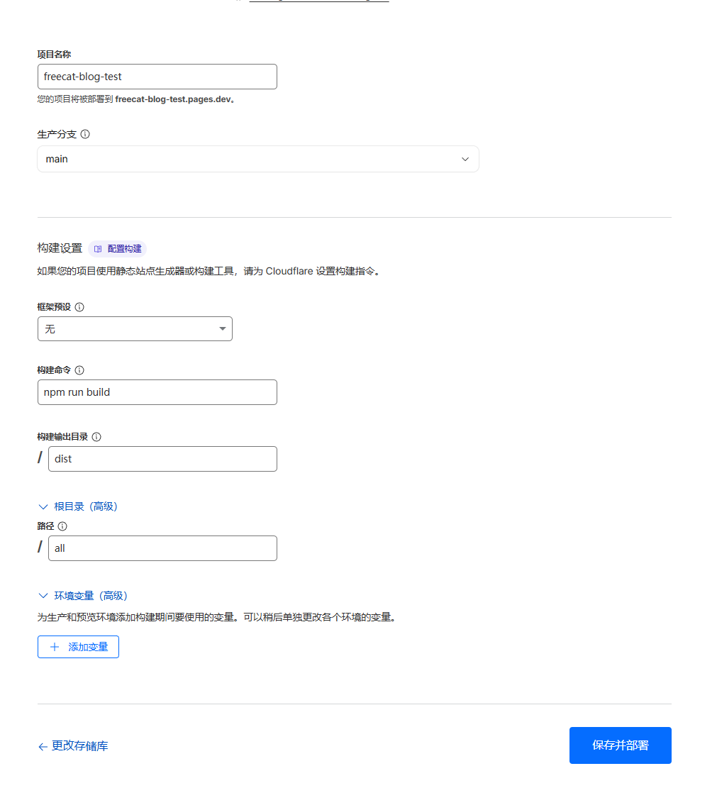

9. 点击 `Save and Deploy`。
10. 等待部署状态显示成功。
11. 打开平台提供的网址，例如 `https://你的项目名.pages.dev`。
12. 确认首页和任意一篇文章均可打开。

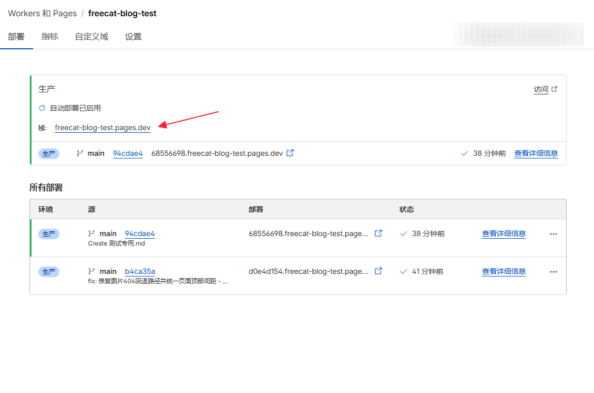

构建时间取决于文件数量、缓存和平台排队情况。若部署失败，查看本次部署的构建日志。

建议在项目设置中启用 `Build cache`（构建缓存），以复用依赖缓存。字体生成不需要 Python。Cloudflare Pages 不会保留本项目的自定义字体子集缓存；不要据此假定后续构建会跳过字体生成。

如果已有域名，在 Pages 项目的自定义域名设置中添加域名，再按提示配置 DNS。DNS 记录用于把域名指向网站。相关资料：[免费域名申请指南](https://blog.freeorg.dpdns.org/posts/2026053112195526)、[DNSHE 自动续期项目](https://github.com/OUBIGFA/dnshe-auto-renew)。

### Vercel

1. 登录 [Vercel](https://vercel.com/)。
2. 选择 `Add New...` → `Project`。
3. 如果尚未连接 GitHub，按页面提示授权 Vercel 访问你的博客仓库。
4. 选择你的博客仓库。
5. 点击 `Root Directory` 右侧的 `Edit`。

   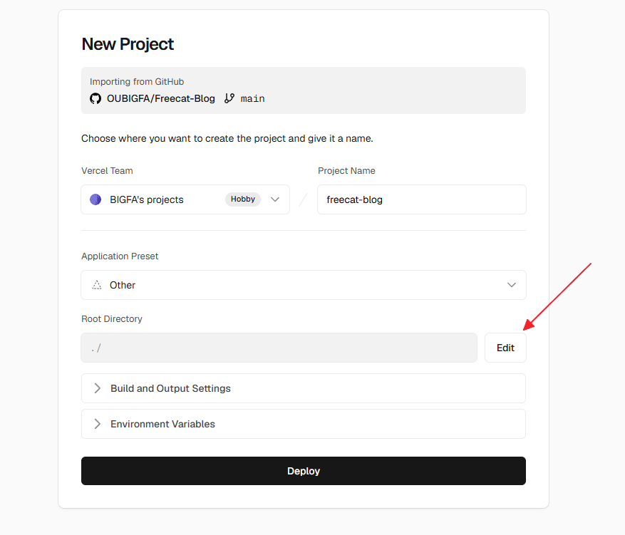

6. 在弹窗中选择 `all` 文件夹。
7. 点击 `Continue`。

   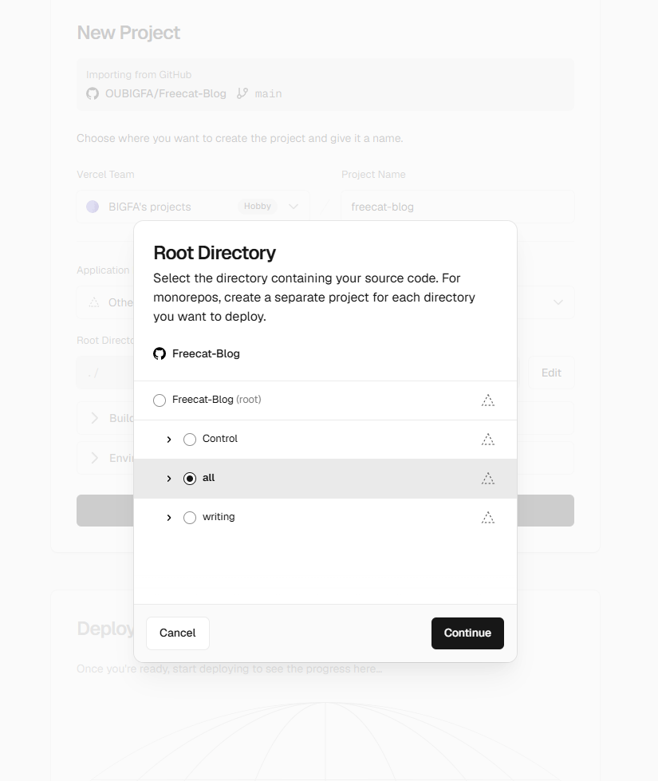

8. 保留 `Build and Output Settings` 的默认设置。
9. 点击 `Deploy`。
10. 等待部署状态显示成功。
11. 打开平台提供的默认网址。
12. 确认首页和任意一篇文章均可打开。

`all/vercel.json` 已配置构建命令、输出目录和页面地址规则。根目录必须是 `all`，Vercel 才能按本项目的目录结构构建。若出现构建失败或 404，先核对根目录和构建日志。

Vercel 可复用构建缓存中的字体子集。只有缓存有效、已覆盖所需字符且字体配置未变化时，构建才会跳过字体生成。

如果已有域名，在项目设置的 `Domains` 中添加域名，再按提示配置 DNS。

## 第 3 步：写文章

在 `writing/` 中，每个 `.md` 文件对应一篇文章。用 Markdown 编辑器打开仓库后，可以新建文章，也可以复制示例文章作为模板。

文章顶部两个 `---` 之间的区域叫 Frontmatter，用于设置标题、日期等文章属性。正文写在第二个 `---` 下方。Frontmatter 可以省略；未填写的属性使用项目默认值。

```md
---
title: 我的第一篇文章
date: 2026-01-01
tag:
  - 随笔
cover:
show_image_captions: true
description:
pinned: false
show: true
copy_content: false
---

这里开始写正文。
```

| 字段 | 作用或填写方法 |
| --- | --- |
| `title` | 文章标题。留空时使用文件名 |
| `date` | 文章显示的发布日期，例如 `2026-01-01` |
| `tag` | 标签。每个标签单独一行，格式见上方示例 |
| `cover` | 封面图片链接。留空时不显示封面 |
| `show_image_captions` | `true` 显示图片说明；`false` 不显示 |
| `description` | 文章摘要。留空时从正文中自动截取 |
| `pinned` | `true` 置顶文章；`false` 不置顶 |
| `show` | `true` 发布文章；`false` 不在网站上展示 |
| `copy_content` | `true` 显示复制正文按钮；`false` 不显示按钮 |

`date` 不是定时发布开关。`copy_content` 不限制读者通过浏览器复制文字。

## 第 4 步：设置网站信息

编辑 `Control/` 中的配置文件。

| 文件 | 设置内容 |
| --- | --- |
| `site_网站属性.md` | 网站标题、站点名、首页介绍、头像、主题 |
| `SEO_搜索优化.md` | 正式域名、搜索摘要、作者信息、AI 爬虫规则和 llms.txt |
| `social_社交媒体.md` | 社交媒体图标、主页链接、联系方式、推广链接 |
| `about_关于页面.md` | About 页面（关于页面）的标题、介绍和头像 |

编辑时遵循以下规则：

- 在文件顶部的 Frontmatter 中修改参数。
- 字段有值时，在冒号后保留一个空格，例如 `site_name: FreeCat`。
- 允许留空的字段保留 `键:`，具体要求见字段旁的说明。
- 保留字段名。`_01`、`_02` 等字段是说明文字，构建时会忽略。

常用设置如下。

| 设置 | 操作 | 结果 |
| --- | --- | --- |
| 默认主题 | 在 `theme_system`、`theme_light`、`theme_dark` 中，将一个设为 `true`，其余设为 `false` | 分别对应跟随系统、浅色、深色。全部为 `false` 时跟随系统 |
| 社交链接 | 将对应的 `*_enabled` 设为 `true`，并填写 `*_url` | 显示该平台的链接，例如 `github_enabled: true` 和 `github_url: https://github.com/你的账号` |
| 社交图标 | 在对应的 `*_icon_url` 中填写图片链接 | 使用自定义图标。留空时使用默认图标 |
| 隐藏社交平台 | 将对应的 `*_enabled` 设为 `false` | 不显示该平台 |
| About 页面 | 编辑 `about_hero_title`、`about_hero_subtitle`、`about_hero_avatar` | 分别设置标题、介绍、头像。各字段留空时使用首页对应内容 |

## 发布日常更新

完成文章或配置修改后，按以下步骤发布。仓库默认分支为 `main`；如果你改过分支名，提交按钮会显示对应名称。

1. 保存修改的文件。
2. 打开 GitHub Desktop。
3. 选择你的博客仓库。
4. 在改动列表中确认本次要发布的文件。
5. 在 `Summary` 中填写提交说明。
6. 点击 `Commit to main`。

   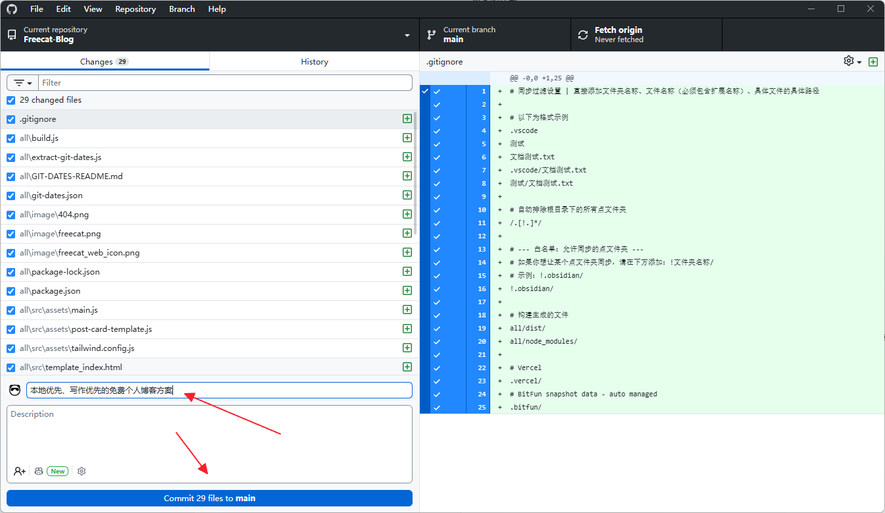

7. 点击 `Push origin`。

   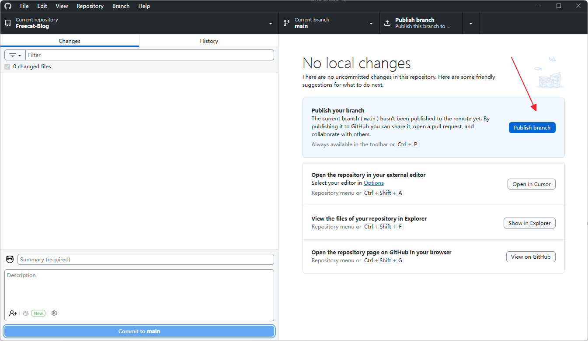

8. 等待部署平台将新提交部署成功。
9. 打开网站检查修改后的内容。

若内容未更新，按下方「常见问题」中的顺序检查。

## 文章内音视频播放器

在 Markdown 图片语法中填入音视频直链，构建时会生成播放器。直链是直接返回媒体文件的地址，不是网盘分享页。将示例地址替换为你的文件地址。

```md


```

如果地址没有音视频扩展名，在方括号中的说明文字前添加 `🎵`（音频）或 `🎬`（视频）。

```md


```

构建时可识别以下扩展名：

- 音频：`.mp3`、`.m4a`、`.wav`、`.ogg`、`.aac`、`.flac`、`.opus`。
- 视频：`.mp4`、`.webm`、`.mov`、`.m4v`、`.ogv`、`.m3u8`。

识别出扩展名不等于浏览器一定能播放。播放还取决于文件编码、浏览器支持和媒体服务器的访问限制。

检查媒体链接：

1. 在未登录媒体网站的浏览器窗口中打开链接。
2. 确认链接直接返回媒体文件，而不是分享页、登录页或提取码页。
3. 将链接写入文章。
4. 在本地预览或发布后点击播放器，确认可以播放。

如果只有分享链接，可尝试 [网盘直链获取工具](https://link.gimhoy.com/)、[分享链接转直链工具](https://lz.qaiu.top/)或[小飞机云盘](https://www.feijipan.com)。是否能生成可用直链取决于服务支持。

如果原来可播放的链接失效，先重新打开直链检查。确认链接过期后，获取新直链并替换文章中的地址，再提交并推送。若直链有效但播放器仍失败，检查文件编码和服务器访问限制。

## 更新模板

GitHub Actions 是仓库内运行自动任务的功能。本项目的 `.github/workflows/sync-upstream.yml` 工作流从主仓库 [OUBIGFA/Freecat-Blog](https://github.com/OUBIGFA/Freecat-Blog) 同步模板文件。

默认计划时间为每周二北京时间 02:17（UTC+8）。定时任务可能延迟，实际执行时间以 `Actions` 记录为准。工作流在主仓库自身运行时会跳过同步。

首次使用前：

1. 打开你的仓库的 `Actions` 页面。
2. 如果 GitHub 提示启用工作流，按提示启用。
3. 确认仓库或组织的权限策略允许工作流写入仓库。

同步范围如下。表中的保留项不随模板替换。

| 范围 | 文件或目录 |
| --- | --- |
| 同步 | `all/`、`README.md`、`README.en.md` |
| 保留本仓库版本 | `all/git-dates.json`、`all/build/font-subsets-manifest.json`、`all/src/assets/fonts/` |
| 不修改 | `Control/`、`writing/`、`.github/`、`.gitignore` |

如果修改过同步范围内的模板、样式、脚本或 README，先保存这些自定义改动的副本；同步可能覆盖它们。

手动运行同步：

1. 打开仓库的 `Actions` 页面。
2. 选择 `Sync upstream template files`。
3. 点击 `Run workflow`。
4. 在运行表单中选择 `main` 分支。
5. 点击表单中的 `Run workflow`。
6. 等待运行记录显示成功。
7. 如果产生了新提交，确认部署平台已部署该提交。

首次运行可能创建同步基准提交。之后若没有待同步的模板变更，工作流会跳过文件更新。

### 处理工作流问题

先查看失败任务的日志，再判断是否需要更新工作流。两个工作流用途不同：

| 工作流 | 用途 |
| --- | --- |
| [sync-upstream.yml](https://github.com/OUBIGFA/Freecat-Blog/blob/main/.github/workflows/sync-upstream.yml) | 同步上表范围内的模板文件 |
| [update-git-dates.yml](https://github.com/OUBIGFA/Freecat-Blog/blob/main/.github/workflows/update-git-dates.yml) | 更新文章日期、固定文章 ID 和最新改动等快照数据 |

如果日志表明你的工作流版本缺少所需修复，将主仓库中对应文件的内容复制到本仓库的同名文件，再提交并推送。工作流文件位于 `.github/workflows/`，不会随模板自动同步。更新文件后，在 `Actions` 中手动运行对应工作流，并检查结果。

如果新功能需要新增配置，从主仓库的 [Control 文件夹](https://github.com/OUBIGFA/Freecat-Blog/tree/main/Control) 查看参数说明，再把需要的参数添加到本仓库对应文件中。保留已有配置值。

## 常见问题

| 问题 | 处理方法 |
| --- | --- |
| 需要会编程吗？ | 日常使用只需编辑 Markdown 和配置文件。修改模板功能时需要相关代码知识 |
| 必须购买域名吗？ | 不需要。Cloudflare Pages 和 Vercel 都提供默认网址 |
| 构建参数怎么检查？ | 根目录为 `all`，输出目录为 `dist`。输出目录相对于根目录，不要填 `all/dist` |
| 可以换部署平台吗？ | 可以。将同一个 GitHub 仓库导入新平台，按本指南配置。如果使用自定义域名，还需修改域名绑定和 DNS |
| 可以删除示例文章吗？ | 可以。删除 `writing/` 中对应文件后，提交并推送 |
| 可以修改 `all/` 吗？ | 可以，但模板同步可能覆盖你的改动。日常写作和网站设置使用 `writing/` 和 `Control/` |

### 本地改了文件，网站没有更新

按以下顺序检查。某项未通过时，先处理该项。

1. 确认编辑器已保存文件。
2. 确认 GitHub Desktop 已提交并推送改动。
3. 确认 GitHub 仓库中能看到修改后的文件。
4. 确认部署平台已部署包含该修改的提交，且部署状态为成功。
5. 在网站页面按 `Ctrl + F5` 强制刷新。

若部署失败，查看构建日志；刷新浏览器不能修复构建失败。

### 使用 .gitignore

`.gitignore` 用于指定 Git 忽略的未跟踪文件。每行写一个规则，例如：

```gitignore
drafts/
Thumbs.db
*.log
```

已被 Git 跟踪的文件不受新规则影响。添加规则不会移除仓库中的文件，也不会清除历史记录。

## 本地预览（可选）

本地预览用于发布前检查内容。部署平台会自行构建网站，因此只在平台部署时不需要本地构建。

1. 安装 [Node.js](https://nodejs.org/)（本项目部署示例使用 Node.js 20）。
2. 在仓库根目录打开终端。
3. 运行 `cd all`，进入构建目录。
4. 首次使用或依赖变化后，运行 `npm install`。
5. 运行 `npm run preview`。
6. 等待终端显示 `Preview ready: http://127.0.0.1:4173/`。
7. 在浏览器中打开 <http://127.0.0.1:4173/>。

`npm run preview` 会先执行完整构建，再启动预览服务。它不会自动打开浏览器，也不会监视后续文件修改。修改内容后，在运行预览的终端按 `Ctrl + C` 停止服务，再运行 `npm run preview`。

构建产物保存在 `all/dist/`。不要手动修改或提交该目录。

## 许可证

本项目使用 MIT License。
